  

# ⚡ Awesome External API Integration & Functions 🌐

  
  
  
  
  
  

> 🌟 **A curated directory of top External API Integration and Serverless Functions platforms** — featuring enterprise cloud SaaS providers, global edge execution networks, and battle-tested open-source self-hosted FaaS engines for high-performance API orchestration and event-driven computing.  
> 🌟 *Star this repository if you find it valuable!* 🌟

---

## 📑 Table of Contents
- [📈 Sector Overview & Market Dynamics](#-sector-overview--market-dynamics)
- [🟦 SaaS & Hosted Serverless Platforms](#-saas--hosted-serverless-platforms)
  - [🏢 Enterprise SaaS Comparison Table](#-enterprise-saas-comparison-table)
  - [🔍 Deep-Dive SaaS Profiles](#-deep-dive-saas-profiles)
- [🟩 Open-Source Serverless & API Runtimes](#-open-source-serverless--api-runtimes)
  - [⭐ Open-Source Solutions Ranked by GitHub_Stars](#-open-source-solutions-ranked-by-github-stars)
  - [🛠️ Deep-Dive Open-Source Engine Profiles](#-deep-dive-open-source-engine-profiles)
- [📊 Feature Matrix & Architecture Comparison](#-feature-matrix--architecture-comparison)
- [⭐ Star History](#-star-history)
- [💖 Support & Sponsorship](#-support--sponsorship)
- [🤝 Contributing](#-contributing)
- [📄 License](#-license)

---

## 📈 Sector Overview & Market Dynamics

The global Serverless Architecture and Function-as-a-Service (FaaS) market is valued at approximately **$15.2 billion to $18.5 billion** and is projected to expand beyond **$45 billion to $55 billion by 2030**, advancing at a Compound Annual Growth Rate (CAGR) of **21.5% to 25.4%**. 

Market dynamics exhibit a **concentrated, oligopolistic core** among cloud hyperscalers (Amazon Web Services, Microsoft Azure, Google Cloud) that control the bulk of enterprise event-driven compute workloads. Concurrently, a **highly dynamic and moderately fragmented tier** thrives along the periphery: edge compute networks (Cloudflare Workers, Fastly Compute), modern frontend runtime platforms (Vercel, Netlify), and specialized database/API orchestrators (Snowflake, Supabase). In parallel, an active **open-source ecosystem** (e.g., n8n, LocalStack, Appwrite, Serverless Framework, Knative) provides critical sovereign, on-premises, and multi-cloud portability, ensuring enterprises avoid strict vendor lock-in.

---

## 🟦 SaaS & Hosted Serverless Platforms

Commercial, managed Function-as-a-Service (FaaS) and API integration platforms ordered strictly by **company scale (market capitalization / valuation)** descending.

### 🏢 Enterprise SaaS Comparison Table

| Platform | Provider / Parent Org | Scale (Valuation / Market Cap) | Starting Tier Pricing | Free Tier / Trial Allowance | Primary Architecture & Fit |
| :--- | :--- | :--- | :--- | :--- | :--- |
| **[Microsoft Azure Functions](https://azure.microsoft.com/en-us/products/functions)** | Microsoft Corporation (`NASDAQ: MSFT`) | **~$3,100 Billion** ($3.1T Market Cap) | **$0.20 per 1M executions** + $0.000016/GB-s (Flex Consumption starts at ~$0.017/instance-hour) | **1,000,000 executions & 400,000 GB-seconds free per month** forever | Enterprise event-driven microservices, .NET integration, Durable stateful functions |
| **[Google Cloud Run Functions](https://cloud.google.com/run)** | Alphabet Inc. (`NASDAQ: GOOGL`) | **~$2,150 Billion** ($2.15T Market Cap) | **$0.40 per 1M invocations** + $0.00002400/vCPU-s + $0.00000250/GiB-s (Tier 1 memory) | **2,000,000 invocations, 180,000 vCPU-sec & 360,000 GiB-sec free per month**; plus $300 90-day GCP trial | OCI container-based serverless deployment, Pub/Sub processing, GCP ecosystem |
| **[AWS Lambda](https://aws.amazon.com/lambda/)** | Amazon.com, Inc. (`NASDAQ: AMZN`) | **~$2,000 Billion** ($2.0T Market Cap) | **$0.20 per 1M requests** ($0.0000002/req) + $0.0000166667 per GB-second for x86 ($0.0000133334 for Graviton) | **1,000,000 free requests & 3,200,000 seconds of compute time (up to 400,000 GB-s) per month** forever | Pioneer hyperscale FaaS, deep AWS event bus & API Gateway integrations |
| **[Cloudflare Workers](https://workers.cloudflare.com/)** | Cloudflare, Inc. (`NYSE: NET`) | **~$36 Billion** ($36B Market Cap) | **$5.00/month** (Workers Paid tier; includes 10M requests + $0.50/M additional requests) | **100,000 requests per day (3,000,000 req/month) free forever** (with 10ms CPU limit per invocation) | Ultra-low latency edge compute, V8 isolates, zero cold start APIs |
| **[Snowflake External Functions](https://www.snowflake.com/)** | Snowflake Inc. (`NYSE: SNOW`) | **~$35 Billion** ($35B Market Cap) | **$2.00 to $4.00 per Snowflake Credit** (Standard $2/credit, Enterprise $3/credit, Business Critical $4/credit) | **30-day free trial with $400 worth of free usage credits** (no permanent free tier for warehouse compute) | SQL-to-API bridge, ML model inference from queries, external data enrichment |
| **[Twilio Functions](https://www.twilio.com/en-us/serverless)** | Twilio Inc. (`NYSE: TWLO`) | **~$12 Billion** ($12B Market Cap) | **$0.0001 per invocation** (Serverless execution pricing after free allowance) | **10,000 invocations per month free forever**; plus $15 trial credit upon sign-up | Telephony webhooks, SMS auto-responders, voice IVR flow automation |
| **[Fastly Compute](https://www.fastly.com/products/compute)** | Fastly, Inc. (`NYSE: FSLY`) | **~$1.2 Billion** ($1.2B Market Cap) | **$50.00/month** flat base commitment package (or usage-rated at $0.50 per 1M requests + $0.00002/GB-sec) | **$50.00/month in free compute usage credits every month** forever | WebAssembly (Wasm) edge logic, custom CDN routing, sub-millisecond headers |
| **[Vercel Functions](https://vercel.com/)** | Vercel Inc. (Private) | **~$3.25 Billion** (Series D Valuation) | **$20.00 per team member/month** (Pro plan; includes 1M function invocations + 1,000 GB-hours compute) | **Hobby Plan free forever**: 100,000 function invocations, 100 GB-hours execution time per month | Next.js API routes, SSR/ISR frontend streaming, web framework serverless APIs |
| **[Netlify Functions](https://www.netlify.com/)** | Netlify Inc. (Private) | **~$2.0 Billion** (Series D Valuation) | **$19.00 per member/month** (Pro plan; includes 25k execution hours & 2M function requests) | **Starter Plan free forever**: 125,000 function requests and 100 hours of compute per month | Jamstack architectures, GitHub-integrated CI/CD serverless web endpoints |
| **[Supabase Edge Functions](https://supabase.com/edge-functions)** | Supabase Inc. (Private) | **~$1.0 Billion** (Series B Valuation) | **$25.00/month** (Pro tier; includes 2M function invocations + $2/M additional invocations) | **Free Plan forever**: 500,000 function invocations per month across all deployed projects | Deno & TypeScript global edge logic, native Postgres Auth & RLS integration |

---

### 🔍 Deep-Dive SaaS Profiles

#### ⚡ [Microsoft Azure Functions](https://azure.microsoft.com/en-us/products/functions)
* **Architecture:** Enterprise event-driven serverless platform with native support for .NET, C#, Python, Java, JavaScript, TypeScript, and PowerShell.
* **Key Capabilities:** Stateful orchestration with Durable Functions, flexible consumption/premium/dedicated container plans, and deep integration with Azure Event Grid, Cosmos DB, and Azure DevOps.
* **Best Suited For:** Enterprise-scale application portfolios and organizations standardizing on Microsoft Cloud infrastructure.

#### ⚡ [Google Cloud Run Functions](https://cloud.google.com/run)
* **Architecture:** Container-centric FaaS (evolution of Google Cloud Functions) running directly on managed Knative-based Cloud Run infrastructure.
* **Key Capabilities:** Scale-to-zero, multi-concurrency per container instance, full binary runtime flexibility, and direct integration with Pub/Sub, Cloud Storage, and BigQuery.
* **Best Suited For:** Workloads requiring custom Linux dependencies, containerized micro-APIs, and Google Cloud environments.

#### ⚡ [AWS Lambda](https://aws.amazon.com/lambda/)
* **Architecture:** The benchmark cloud FaaS runtime executing code in microVMs (Firecracker) across global AWS regions.
* **Key Capabilities:** Graviton2 ARM architecture support, Lambda SnapStart for near-zero Java cold starts, provisioned concurrency, and event-source mappings across 200+ AWS services.
* **Best Suited For:** High-throughput microservices, real-time streaming data ingestion, and cloud-native backends on AWS.

#### ⚡ [Cloudflare Workers](https://workers.cloudflare.com/)
* **Architecture:** Ultra-fast V8 isolate execution deployed across 330+ points of presence worldwide.
* **Key Capabilities:** Under 5ms cold starts, integrated edge state via Workers KV, Vectorize (vector DB), D1 (distributed SQL), and Workers AI GPU inference.
* **Best Suited For:** Latency-critical API gateways, reverse proxy transforms, and distributed modern web applications.

#### ⚡ [Snowflake External Functions](https://www.snowflake.com/)
* **Architecture:** Direct SQL engine external compute extension using secure cloud proxy bridges (AWS API Gateway, Azure API Management).
* **Key Capabilities:** Vectorized row batching, bi-directional payload transformation, and execution of proprietary ML/NLP models without moving data outside Snowflake governance.
* **Best Suited For:** Enterprise data warehouse pipelines, feature stores, and real-time external API data lookups in analytical SQL queries.

#### ⚡ [Twilio Functions](https://www.twilio.com/en-us/serverless)
* **Architecture:** Managed Node.js serverless execution framework built specifically for Twilio Runtime.
* **Key Capabilities:** Automatic Twilio signature authentication, zero-credential helper clients, and immediate deployment for voice, SMS, and WhatsApp webhooks.
* **Best Suited For:** Customer engagement workflows, real-time IVR menus, and communication automated bots.

#### ⚡ [Fastly Compute](https://www.fastly.com/products/compute)
* **Architecture:** WebAssembly-driven edge platform offering memory safety and 35-microsecond startup execution.
* **Key Capabilities:** Compiles Rust, Go, JavaScript, and C++ to Wasm; tight coupling with Fastly's high-speed cache purge mechanism.
* **Best Suited For:** High-performance content manipulation, cryptographic token inspection, and zero-latency CDN edge routing.

#### ⚡ [Vercel Functions](https://vercel.com/)
* **Architecture:** Worldwide distributed serverless & edge compute environment customized for modern web framework runtimes.
* **Key Capabilities:** Web standard Request/Response architecture, background task execution via `waitUntil`, dynamic streaming responses, and preview branch deployments.
* **Best Suited For:** Fullstack Next.js, SvelteKit, and Nuxt developers shipping web applications and API routes.

#### ⚡ [Netlify Functions](https://www.netlify.com/)
* **Architecture:** Git-driven serverless compute running AWS Lambda and Deno edge workers under a simplified single interface.
* **Key Capabilities:** Zero-config local development (`netlify dev`), background long-running functions (up to 15 mins), and automated deploy hook triggers.
* **Best Suited For:** Headless CMS sites, Jamstack static web architectures, and serverless form processing.

#### ⚡ [Supabase Edge Functions](https://supabase.com/edge-functions)
* **Architecture:** Globally distributed Deno runtime integrated with Postgres, GoTrue Auth, and Storage.
* **Key Capabilities:** Instant TypeScript support without build steps, native JWT validation, and direct local database access via Supabase client libraries.
* **Best Suited For:** Developers utilizing the Supabase BaaS stack needing webhook handlers, Stripe payments processing, and AI workflows.

---

## 🟩 Open-Source Serverless & API Runtimes

Self-hosted, transparent, and community-driven serverless platforms. All projects are sorted strictly by **GitHub Stargazer Count (descending)** and include direct social badges linking to their stargazers page.

### ⭐ Open-Source Solutions Ranked by GitHub_Stars

| Repository | GitHub_Stars_Badge | Primary Language / Stack | License | Core Focus |
| :--- | :--- | :--- | :--- | :--- |
| **[n8n](https://github.com/n8n-io/n8n)** |  | TypeScript / Node.js | Fair-Code (Sustainable Use License) | Visual workflow automation & external API integration orchestrator |
| **[LocalStack](https://github.com/localstack/localstack)** |  | Python / Docker | Apache-2.0 (Core) | Fully functional local AWS cloud stack & Lambda runtime emulator |
| **[Appwrite](https://github.com/appwrite/appwrite)** |  | Dart / PHP / Docker | BSD-3-Clause | Complete self-hosted BaaS with multi-language serverless functions |
| **[Serverless Framework](https://github.com/serverless/serverless)** |  | JavaScript / Node.js | MIT / Commercial (v4+) | Universal CLI framework for deploying functions across cloud hyperscalers |
| **[SST](https://github.com/anomalyco/sst)** |  | TypeScript / Go | MIT | Modern serverless framework with live local debugging for AWS and edge |
| **[OpenFaaS](https://github.com/openfaas/faas)** |  | Go / Kubernetes / Docker | MIT (Core Engine) | Containerized FaaS for Kubernetes and Docker Swarm with auto-scaling |
| **[Dapr](https://github.com/dapr/dapr)** |  | Go / Kubernetes | Apache-2.0 | Distributed Application Runtime providing event-driven API bindings |
| **[Activepieces](https://github.com/activepieces/activepieces)** |  | TypeScript / Node.js | MIT | Open-source Zapier alternative for self-hosted API and function workflows |
| **[Fission](https://github.com/fission/fission)** |  | Go / Kubernetes | Apache-2.0 | Fast, Kubernetes-native serverless framework with warm container pooling |
| **[Kubeless](https://github.com/vmware-archive/kubeless)** |  | Go / Kubernetes | Apache-2.0 | Native Kubernetes CRD-based serverless framework *(Archived reference)* |
| **[Apache OpenWhisk](https://github.com/apache/openwhisk)** |  | Scala / Docker / K8s | Apache-2.0 | Distributed enterprise FaaS executing actions in response to event triggers |
| **[Knative Serving](https://github.com/knative/serving)** |  | Go / Kubernetes | Apache-2.0 | Kubernetes building blocks for scale-to-zero request-driven serverless containers |
| **[Nuclio](https://github.com/nuclio/nuclio)** |  | Go / Kubernetes | Apache-2.0 | Ultra-high-performance serverless framework tailored for data, streaming & AI/ML |
| **[Zappa](https://github.com/zappa/Zappa)** |  | Python | MIT | Serverless deployment tool for Python WSGI & ASGI web frameworks (Django, Flask) |
| **[OpenFunction](https://github.com/OpenFunction/OpenFunction)** |  | Go / Kubernetes / Dapr | Apache-2.0 | Cloud-native serverless platform integrating Knative, Tekton, Shipwright & KEDA |

---

### 🛠️ Deep-Dive Open-Source Engine Profiles

#### 🌟 [n8n](https://github.com/n8n-io/n8n)
* **Repository:** [`n8n-io/n8n`](https://github.com/n8n-io/n8n) | 
* **Architecture:** Fair-code licensed node-based workflow orchestration and API integration system.
* **Why it stands out:** Offers 400+ native external API nodes, custom JavaScript/Python code execution blocks, webhook triggers, and enterprise privacy through self-hosting via Docker or Kubernetes.

#### 🌟 [LocalStack](https://github.com/localstack/localstack)
* **Repository:** [`localstack/localstack`](https://github.com/localstack/localstack) | 
* **Architecture:** Emulated AWS cloud test environment executing entirely inside a local Docker container.
* **Why it stands out:** Allows testing AWS Lambda functions, API Gateway HTTP/REST routes, EventBridge, S3, and SQS locally without incurring AWS cloud bills or requiring cloud internet access.

#### 🌟 [Appwrite](https://github.com/appwrite/appwrite)
* **Repository:** [`appwrite/appwrite`](https://github.com/appwrite/appwrite) | 
* **Architecture:** Unified backend-as-a-service platform with isolated containerized runtime executors.
* **Why it stands out:** Features an integrated Functions runtime supporting 13+ languages (Python, Node.js, Deno, Dart, Ruby, Go, PHP, etc.) with scheduled cron triggers, API keys, and automatic SSL.

#### 🌟 [Serverless Framework](https://github.com/serverless/serverless)
* **Repository:** [`serverless/serverless`](https://github.com/serverless/serverless) | 
* **Architecture:** Declarative Infrastructure-as-Code CLI framework utilizing `serverless.yml`.
* **Why it stands out:** Supports multi-cloud deployments (AWS Lambda, Google Cloud Functions, Azure Functions) with extensive plugin ecosystems for packaging, bundling, and environment lifecycle management.

#### 🌟 [SST](https://github.com/anomalyco/sst)
* **Repository:** [`anomalyco/sst`](https://github.com/anomalyco/sst) | 
* **Architecture:** Modern full-stack infrastructure framework built for rapid serverless development.
* **Why it stands out:** Live Lambda development environment proxies remote AWS requests to your local terminal instantly without deploying mocks, reducing deployment iterations from minutes to milliseconds.

#### 🌟 [OpenFaaS](https://github.com/openfaas/faas)
* **Repository:** [`openfaas/faas`](https://github.com/openfaas/faas) | 
* **Architecture:** Cloud-native function gateway and orchestration system running on standard Kubernetes and Docker.
* **Why it stands out:** Treats any Docker container as a serverless function with built-in Prometheus metrics, auto-scaling from 0 to N, and an accessible Web UI and CLI.

#### 🌟 [Dapr (Distributed Application Runtime)](https://github.com/dapr/dapr)
* **Repository:** [`dapr/dapr`](https://github.com/dapr/dapr) | 
* **Architecture:** CNCF graduated portable, event-driven sidecar runtime for microservices.
* **Why it stands out:** Exposes standard HTTP and gRPC APIs for external bindings, pub/sub messaging, state management, and secret stores regardless of host infrastructure.

#### 🌟 [Activepieces](https://github.com/activepieces/activepieces)
* **Repository:** [`activepieces/activepieces`](https://github.com/activepieces/activepieces) | 
* **Architecture:** Self-hostable, TypeScript-based workflow automation engine.
* **Why it stands out:** MIT-licensed open-source alternative to Zapier with sandboxed code runners, community-contributed external API connectors, and automated webhook reception.

#### 🌟 [Fission](https://github.com/fission/fission)
* **Repository:** [`fission/fission`](https://github.com/fission/fission) | 
* **Architecture:** High-velocity serverless framework optimized for Kubernetes.
* **Why it stands out:** Maintains a warm pool of pre-warmed generic containers, bringing cold-start latency down to under 100 milliseconds for Python, Node.js, Go, and C# functions.

#### 🌟 [Apache OpenWhisk](https://github.com/apache/openwhisk)
* **Repository:** [`apache/openwhisk`](https://github.com/apache/openwhisk) | 
* **Architecture:** Highly scalable, distributed event-driven compute engine governed by the Apache Software Foundation.
* **Why it stands out:** Powers industrial FaaS backends, featuring advanced feed event providers, asynchronous execution queues via Apache Kafka, and strict container isolation.

#### 🌟 [Knative Serving](https://github.com/knative/serving)
* **Repository:** [`knative/serving`](https://github.com/knative/serving) | 
* **Architecture:** Kubernetes custom resource definitions (CRDs) for serverless container serving.
* **Why it stands out:** Powers enterprise cloud platforms (such as Google Cloud Run); delivers automatic routing, point-in-time revision tracking, and rapid scale-to-zero capability.

#### 🌟 [Nuclio](https://github.com/nuclio/nuclio)
* **Repository:** [`nuclio/nuclio`](https://github.com/nuclio/nuclio) | 
* **Architecture:** Extreme-performance real-time event and data processing platform.
* **Why it stands out:** Up to 100x faster execution than legacy FaaS runtimes, capable of processing hundreds of thousands of events per second with hardware acceleration (GPU) support for AI inference.

#### 🌟 [OpenFunction](https://github.com/OpenFunction/OpenFunction)
* **Repository:** [`OpenFunction/OpenFunction`](https://github.com/OpenFunction/OpenFunction) | 
* **Architecture:** Modern cloud-native serverless architecture combining Knative, KEDA, Dapr, and Shipwright.
* **Why it stands out:** Bridges sync and async serverless models, seamlessly auto-scaling based on event queue length and supporting source-to-container automated builds.

#### 🌟 [Zappa](https://github.com/zappa/Zappa)
* **Repository:** [`zappa/Zappa`](https://github.com/zappa/Zappa) | 
* **Architecture:** Python serverless application deployment framework.
* **Why it stands out:** Enables 1-command deployment of standard Django, Flask, and Falcon WSGI applications directly to AWS Lambda and Amazon API Gateway with seamless staging.

---

## 📊 Feature Matrix & Architecture Comparison

| Category | Platform / Tool | Protocol / Trigger Support | Language Ecosystem | Hosting Model |
| :--- | :--- | :--- | :--- | :--- |
| **Enterprise Cloud SaaS** | Microsoft Azure Functions | HTTP, Timer, Blob, Event Hub, Service Bus, Cosmos DB | C#, F#, Java, JavaScript, Python, PowerShell | Managed Cloud |
| **Enterprise Cloud SaaS** | Google Cloud Run Functions | HTTP, Cloud Storage, Pub/Sub, Firestore, Cloud Tasks | Node.js, Python, Go, Java, .NET, Ruby, PHP | Managed Cloud |
| **Enterprise Cloud SaaS** | AWS Lambda | API Gateway, S3, DynamoDB, SQS, Kinesis, EventBridge | Node.js, Python, Java, Go, Ruby, .NET, Custom | Managed Cloud |
| **Edge Compute SaaS** | Cloudflare Workers | HTTP/HTTPS Fetch, WebSockets, Cron, Queue Consumers | JavaScript, TypeScript, Python, Rust, Wasm | Global Anycast Edge |
| **Enterprise Cloud SaaS** | Snowflake External Functions | Cloud API Management Proxy, HTTPS Batch Endpoints | Any language supported behind API Gateway / Lambda | Snowflake SaaS |
| **Communications SaaS** | Twilio Functions | Twilio Webhooks, Voice Calls, SMS Events, HTTP | Node.js | Managed Cloud |
| **Edge Compute SaaS** | Fastly Compute | HTTP/HTTPS, WebSockets, Cache Hooks | Rust, JavaScript, TypeScript, Go, Wasm | Global Edge POPs |
| **Web Runtime SaaS** | Vercel Functions | HTTP Fetch, Server Actions, Edge Streaming | Node.js, Edge Runtime, Python, Ruby, Go | Distributed Edge/Serverless |
| **Web Runtime SaaS** | Netlify Functions | HTTP Request, Form Submissions, Identity, Deploy Hooks | Node.js, TypeScript, Go | Distributed Cloud |
| **Edge Backend SaaS** | Supabase Edge Functions | HTTP Request, Postgres Webhooks, Database Triggers | Deno (TypeScript, JavaScript) | Global Edge Network |
| **Workflow / API OSS** | n8n | Webhook, Cron, Pollers, 400+ External APIs | TypeScript / Node.js | Self-Hosted / Docker / Cloud |
| **Emulation OSS** | LocalStack | AWS SDKs, REST API, Lambda Invocations | Python / Docker | Localhost / On-Premise |
| **BaaS & Functions OSS** | Appwrite | HTTP, Crons, Database Events, Auth Events | 13+ Languages (Node, Python, Go, Ruby, etc.) | Self-Hosted Docker / Cloud |
| **IaC Deployment OSS** | Serverless Framework | AWS, Azure, GCP, Knative API Gateways | Polyglot (Defined in template) | CLI Deployment Tool |
| **Fullstack Tooling OSS** | SST | AWS Lambda, Cloudflare Workers, Ion Engine | TypeScript, JavaScript, Python | CLI / Cloud |
| **Kubernetes FaaS OSS** | OpenFaaS | HTTP Gateway, NATS Message Bus, Cron, Kafka | Docker Container (Any Language) | Kubernetes / Docker Swarm |
| **Distributed Mesh OSS** | Dapr | HTTP, gRPC, CloudEvents, Message Brokers | Any Language via HTTP/gRPC Sidecar | Kubernetes / Edge / VM |
| **Workflow / API OSS** | Activepieces | Webhooks, Triggers, Third-Party OAuth Actions | TypeScript / Node.js | Self-Hosted / Docker / Cloud |
| **Kubernetes FaaS OSS** | Fission | HTTP, NATS, Kafka, Timers, Kubernetes Watches | Go, Python, Node.js, C#, PHP | Kubernetes Cluster |
| **Distributed FaaS OSS** | Apache OpenWhisk | REST API, Kafka, Cloudant, Alarm Triggers | NodeJS, Python, Java, Go, Scala, Docker | Self-Hosted / Kubernetes |
| **Kubernetes Serving OSS** | Knative Serving | HTTP, gRPC, CloudEvents via Knative Eventing | Containerized Application (Any Language) | Kubernetes Cluster |
| **Data / ML FaaS OSS** | Nuclio | HTTP, Kafka, Kinesis, RabbitMQ, MQTT, Cron | Go, Python, Java, Node.js, Shell | Kubernetes / Docker |
| **Cloud-Native OSS** | OpenFunction | HTTP, KEDA Triggers, Dapr Bindings | Go, Node.js, Python, Java | Kubernetes Cluster |
| **Python Tooling OSS** | Zappa | API Gateway, ALB, S3 Events, SNS, SES, DynamoDB | Python (WSGI / ASGI) | AWS Lambda Serverless |

## ⭐ Star History

---

## 💖 Support & Sponsorship

Thank you for exploring and utilizing this curated directory! Maintaining high-quality, up-to-date benchmarks of serverless architectures, external API integrations, and developer tooling requires continuous research and dedication.

If you find this project valuable, here are a few meaningful ways you can support:
- ⭐ **Star this repository** to help others discover it across GitHub.
- 🍴 **Fork and contribute** by adding new tools, updates, and benchmark observations.
- 📢 **Share with colleagues & developer communities** on social media, blogs, or tech forums.
- ☕ **Buy me a coffee & sponsor my open-source work**: Support sustained maintenance via the **[GitHub Sponsors Dashboard](https://github.com/sponsors/ishandutta2007)**!

Your support and contributions keep this repository thriving and freely accessible to everyone in the engineering community! 🚀

---

## 🤝 Contributing

Contributions and additions are enthusiastically welcomed! 🚀 If you maintain or use an open-source External API Integration tool or serverless platform that is not yet cataloged here, please feel free to submit a Pull Request.

### 📝 Submission Checklist
1. **Repository Link:** Ensure the project is active (commits or releases within the past 12 months).
2. **Open-Source License:** Must possess a recognized OSI-compatible or source-available license.
3. **Format & Consistency:** Include Stars_Badge formatted as ``.
4. **Detail Profile:** Add a 1–2 sentence description emphasizing core capabilities and best-fit use cases.

---

## 📄 License

This compilation is distributed under the **[Creative Commons Zero v1.0 Universal](LICENSE)** (Public Domain Dedication). All referenced product names, logos, and registered trademarks belong to their respective corporate and open-source owners.

---

  ⭐ <b>Found this curated list helpful? Consider starring the repository to support continuous updates!</b> ⭐

